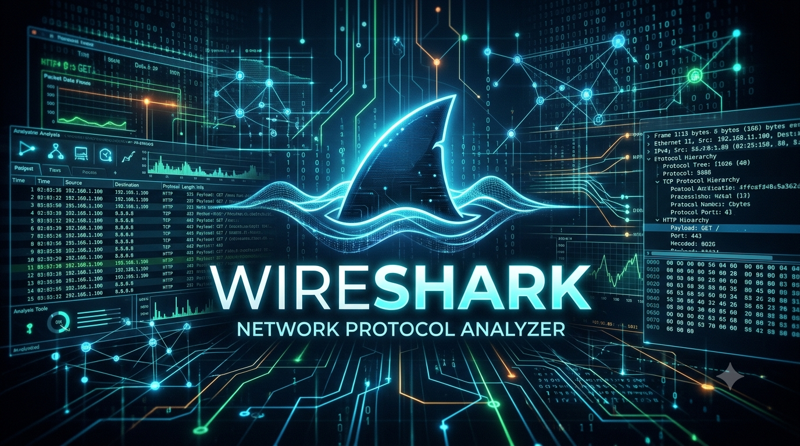
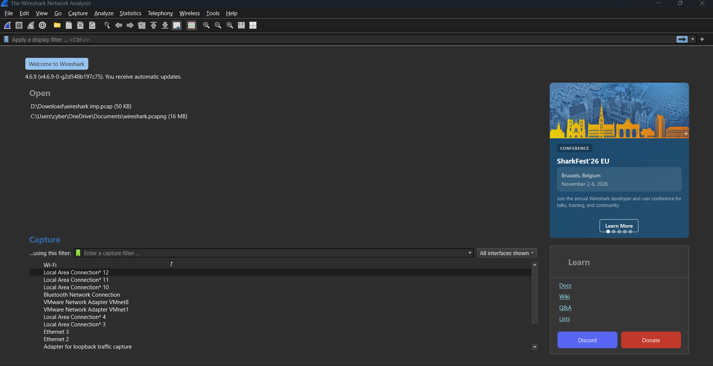
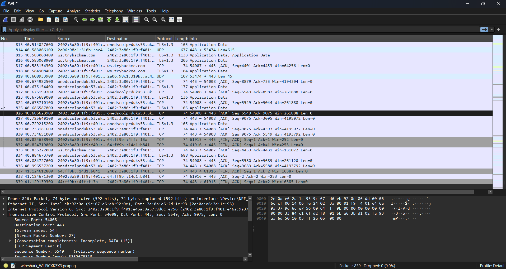
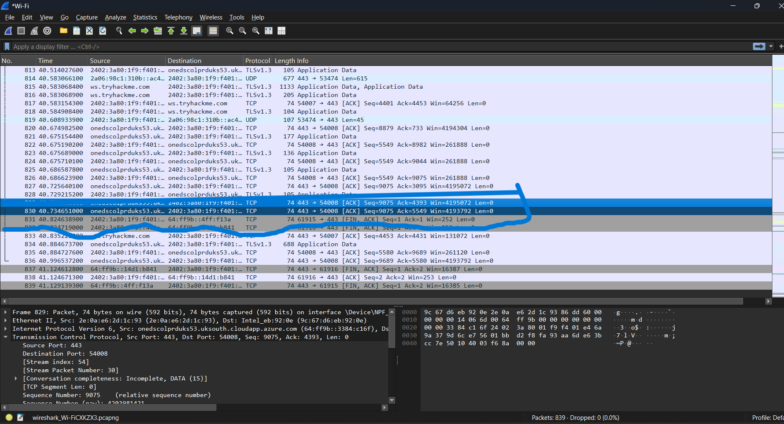
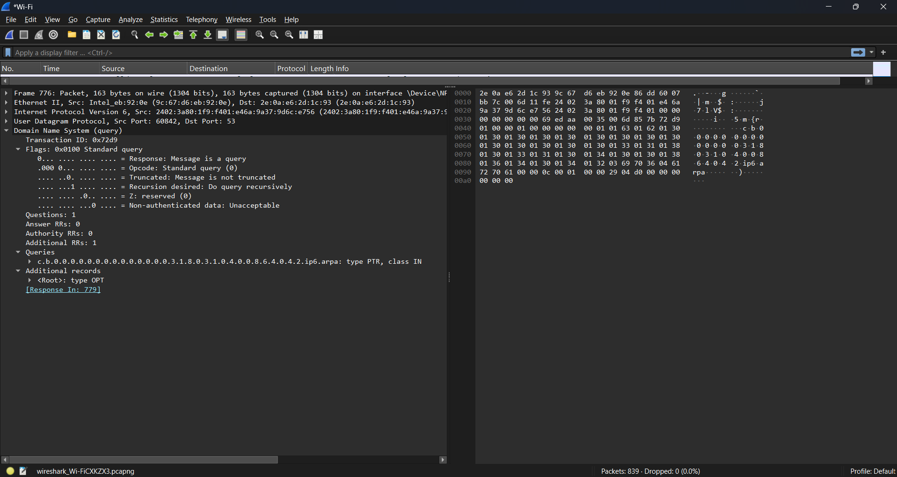
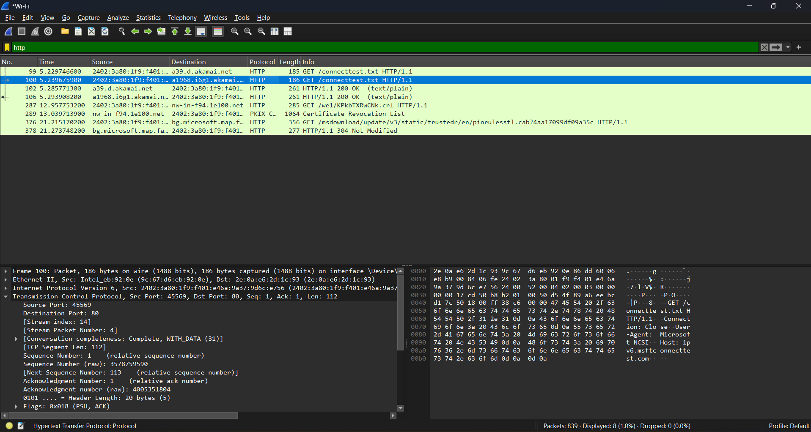
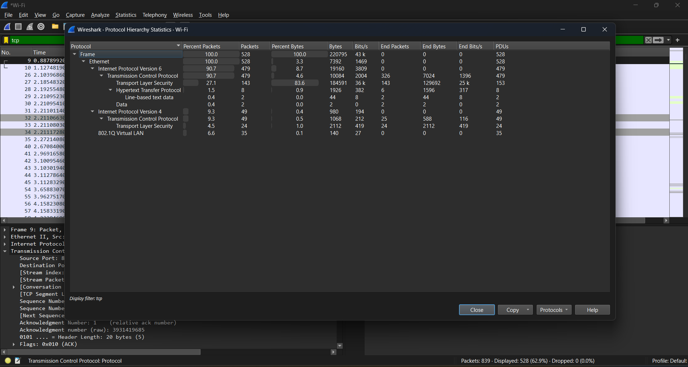
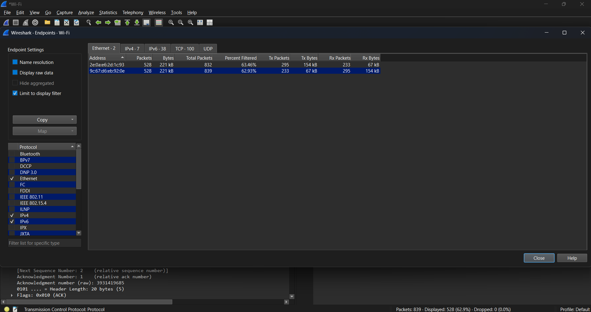
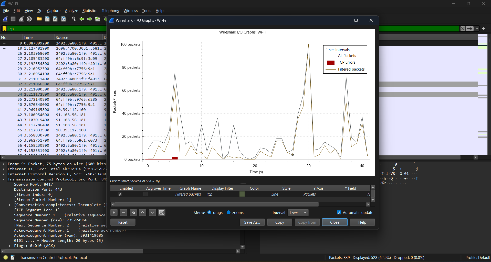

 <div align="center">



# ⚡ WIRESHARK // NETWORK TRAFFIC ANALYSIS

### `> Decode Packets | Analyze Protocols | Investigate Network Traffic`


**OMJEE OJHA**

Cybersecurity Student | UPSIFS  
Cybersecurity Intern | NetworkWalks

</div>

---

```text
╔══════════════════════════════════════════════════════════════╗
║                 NETWORK ANALYSIS TERMINAL                    ║
╠══════════════════════════════════════════════════════════════╣
║  [OK] Initializing packet analyzer                            ║
║  [OK] Loading network protocols                               ║
║  [OK] Preparing traffic inspection                            ║
║  [OK] TCP/IP analysis module                                  ║
║  [ACTIVE] Network investigation                               ║
╚══════════════════════════════════════════════════════════════╝
```

# `01 // ABOUT THE PROJECT`

A practical, beginner-friendly documentation project focused on **network traffic analysis using Wireshark**.

This repository documents my learning and practical exploration of packet capture, protocol inspection, network communication, traffic filtering, and cybersecurity investigation.

### Main objectives

- Understand how packets travel across networks.
- Analyze TCP, UDP, DNS, HTTP, HTTPS and other protocols.
- Understand the OSI and TCP/IP models through real packet captures.
- Identify suspicious network communication patterns.
- Learn to investigate port scanning and brute-force indicators.
- Understand how to troubleshoot network communication.
- Develop practical packet analysis and reporting skills.

> The objective is not just to run filters, but to understand what the captured packets actually reveal.

# `02 // WHAT IS WIRESHARK?`

Wireshark is an open-source network protocol analyzer used to capture and inspect network packets.

It allows us to examine:
- Source and destination IP addresses.
- Source and destination ports.
- Network protocols.
- TCP flags and sequence numbers.
- DNS queries and responses.
- HTTP requests and responses.
- TLS handshake information.
- Packet timing and communication patterns.

**Important:** Wireshark analyzes captured traffic. It does not automatically decrypt HTTPS or bypass network encryption.

# `03 // NETWORK INTERFACES`

A network interface is a point through which a system sends or receives network traffic.

| Interface | Purpose |
|---|---|
| `eth0` | Ethernet network interface |
| `wlan0` | Wireless network interface |
| `lo` | Loopback interface |
| `any` | Captures from supported Linux interfaces |
| `tun0` | Commonly used by VPN tunnels |
| `tap0` | Virtual Layer 2 interface |
| `docker0` | Docker virtual bridge |
| `vboxnet0` | VirtualBox host-only interface |
| `nflog` | Captures packets delivered through Linux NFLOG |
| `nfqueue` | Receives packets from Linux Netfilter queues |

### Linux commands

```bash
ip addr
ip route
ip link show
ifconfig
```

### Wireshark capture workflow

1. Open Wireshark.
2. Identify available interfaces.
3. Observe packet activity.
4. Select the required interface.
5. Start packet capture.
6. Apply display filters.
7. Inspect individual packets.



# `04 // UNDERSTANDING PACKET STRUCTURE`

A packet contains multiple layers of information.

Example:

```text
Ethernet Frame
      |
      v
IP Header
      |
      v
TCP / UDP Header
      |
      v
Application Data
```

### Important packet fields

| Field | Meaning |
|---|---|
| Source MAC | Sender's hardware address |
| Destination MAC | Receiver's hardware address |
| Source IP | Sender's IP address |
| Destination IP | Receiver's IP address |
| Source Port | Application's sending port |
| Destination Port | Application's receiving port |
| Protocol | TCP, UDP, ICMP etc. |
| Length | Packet/frame length |
| TTL | IP packet lifetime limit |

### OSI model and packet analysis

| Layer | Name | Example |
|---|---|---|
| 7 | Application | HTTP, DNS |
| 6 | Presentation | Data encoding, encryption |
| 5 | Session | Session management |
| 4 | Transport | TCP, UDP |
| 3 | Network | IPv4, IPv6, ICMP |
| 2 | Data Link | Ethernet, ARP |
| 1 | Physical | Cables, radio signals |



# `05 // CAPTURE FILTERS VS DISPLAY FILTERS`

These two filter types serve different purposes.

### Capture Filters

Capture filters decide which packets Wireshark records.

Examples:

```bash
host 192.168.1.10
```

```bash
net 192.168.1.0/24
```

```bash
port 80
```

```bash
tcp
```

```bash
udp
```

### Display Filters

Display filters are applied after packets have been captured.

Examples:

```wireshark
ip.addr == 192.168.1.10
```

```wireshark
tcp
```

```wireshark
udp
```

```wireshark
dns
```

```wireshark
http
```

```wireshark
tls
```

```wireshark
icmp
```

# `06 // WIRESHARK DISPLAY FILTER CHEAT SHEET`

### IP filters

```wireshark
ip
ip.src == 192.168.1.10
ip.dst == 192.168.1.10
ip.addr == 192.168.1.10
ip.ttl < 64
```

### TCP filters

```wireshark
tcp
tcp.port == 443
tcp.srcport == 80
tcp.dstport == 443
tcp.flags.syn == 1
tcp.flags.ack == 1
tcp.flags.reset == 1
tcp.flags.fin == 1
tcp.analysis.retransmission
tcp.analysis.duplicate_ack
tcp.analysis.zero_window
tcp.stream eq 0
```

### UDP filters

```wireshark
udp
udp.port == 53
udp.srcport == 53
udp.dstport == 53
udp.length > 100
```

### DNS filters

```wireshark
dns
dns.flags.response == 0
dns.flags.response == 1
dns.qry.name
dns.qry.type == 1
dns.a
dns.aaaa
dns.cname
dns.resp.ttl
```

### HTTP filters

```wireshark
http
http.request
http.response
http.request.method == "GET"
http.request.method == "POST"
http.response.code == 200
http.response.code == 404
http.host
http.request.uri
http.user_agent
```

### TLS filters

```wireshark
tls
tls.handshake
tls.handshake.type == 1
tls.handshake.type == 2
tls.handshake.extensions_server_name
tls.alert
```

### ARP filters

```wireshark
arp
arp.opcode == 1
arp.opcode == 2
arp.src.proto_ipv4
arp.dst.proto_ipv4
```

### ICMP filters

```wireshark
icmp
icmp.type == 8
icmp.type == 0
icmp.type == 3
```

### DHCP filters

```wireshark
dhcp
bootp
```

Depending on the Wireshark version and field aliases, DHCP traffic may be displayed using either filter.

### Investigation filters

```wireshark
tcp.flags.syn == 1 && tcp.flags.ack == 0
```

```wireshark
tcp.flags.reset == 1
```

```wireshark
dns.flags.rcode != 0
```

```wireshark
http.request.method == "POST"
```

```wireshark
tcp.analysis.retransmission
```

# `07 // TCP THREE-WAY HANDSHAKE`

TCP establishes a connection through a three-step handshake.

```text
          CLIENT                    SERVER
             |                         |
             |-------- SYN ----------->|
             |                         |
             |<----- SYN + ACK --------|
             |                         |
             |-------- ACK ----------->|
             |                         |
             |     CONNECTION          |
             |      ESTABLISHED         |
```

### Explanation

1. SYN: Client requests a TCP connection.
2. SYN-ACK: Server acknowledges and responds.
3. ACK: Client acknowledges the response.

### Useful filters

```wireshark
tcp.flags.syn == 1
```

```wireshark
tcp.flags.syn == 1 && tcp.flags.ack == 0
```

```wireshark
tcp.flags.syn == 1 && tcp.flags.ack == 1
```

```wireshark
tcp.flags.ack == 1 && tcp.flags.syn == 0
```



# `08 // DNS TRAFFIC ANALYSIS`

DNS translates domain names into IP addresses.

Example:

```text
Client
  |
  | DNS Query: example.com
  |
  v
DNS Resolver
  |
  | DNS Response: 93.184.216.34
  |
  v
Client
```

### Important DNS record types

| Record | Purpose |
|---|---|
| A | IPv4 address |
| AAAA | IPv6 address |
| CNAME | Alias of another domain |
| MX | Mail server |
| NS | Name server |
| TXT | Text information |
| SOA | Zone authority information |
| PTR | Reverse DNS lookup |
| SRV | Service location |

### DNS investigation filters

```wireshark
dns
```

```wireshark
dns.flags.response == 0
```

```wireshark
dns.flags.response == 1
```

```wireshark
dns.qry.name contains "example"
```

```wireshark
dns.a
```

```wireshark
dns.cname
```

```wireshark
dns.flags.rcode != 0
```

### What to investigate

- Which domain was requested?
- Which client generated the query?
- Which DNS server received it?
- What response was returned?
- Was the query successful?
- Were repeated or unusual domain queries observed?



# `09 // HTTP AND HTTPS ANALYSIS`

HTTP is an application-layer protocol used for web communication.

HTTPS adds TLS encryption to protect communication.

### Common HTTP methods

| Method | Purpose |
|---|---|
| GET | Retrieve data |
| POST | Submit data |
| PUT | Update or create a resource |
| DELETE | Delete a resource |
| HEAD | Retrieve response headers |

### Useful HTTP filters

```wireshark
http
```

```wireshark
http.request
```

```wireshark
http.response
```

```wireshark
http.request.method == "GET"
```

```wireshark
http.request.method == "POST"
```

```wireshark
http.response.code == 200
```

```wireshark
http.response.code == 404
```

```wireshark
http.host
```

```wireshark
http.request.uri
```

### HTTPS / TLS investigation

```wireshark
tls
```

```wireshark
tls.handshake
```

```wireshark
tls.handshake.type == 1
```

```wireshark
tls.handshake.extensions_server_name
```

### What to investigate

- Client and server IP addresses.
- HTTP methods and status codes.
- Requested hostnames and URIs.
- TLS handshake information.
- Certificates and negotiated protocol details, where visible.

**Security note:** HTTPS application payloads are normally encrypted. A packet capture alone does not reveal passwords or cookies inside encrypted HTTPS traffic.



# `10 // PORT SCANNING INDICATORS`

Port scanning is a technique used to discover available network services.

Wireshark can help identify patterns associated with scanning.

### Common indicators

- One source IP contacting many destination ports.
- Repeated TCP SYN packets.
- Repeated connection attempts.
- RST responses from closed ports.
- Multiple connection attempts within a short period.

### Useful filters

```wireshark
tcp.flags.syn == 1 && tcp.flags.ack == 0
```

```wireshark
tcp.flags.reset == 1
```

```wireshark
tcp.flags.syn == 1 && tcp.analysis.retransmission
```

### Investigation workflow

1. Identify the source IP.
2. Identify the target IP.
3. Inspect destination ports.
4. Check SYN and RST flags.
5. Compare timestamps.
6. Examine repeated connection patterns.
7. Document findings.

**Important:** A SYN packet alone does not prove an attack. Correlate packet patterns and context before drawing conclusions.

# `11 // BRUTE-FORCE TRAFFIC ANALYSIS`

Brute-force attacks involve repeated authentication attempts to guess credentials.

### Possible network indicators

- Repeated login requests.
- Multiple authentication attempts.
- Repeated connections from one source.
- HTTP 401 or 403 responses.
- Unusual request frequency.

### Useful filters

```wireshark
http.request.method == "POST"
```

```wireshark
http.response.code == 401
```

```wireshark
http.response.code == 403
```

```wireshark
tcp.stream eq 0
```

### Investigation workflow

1. Identify the application protocol.
2. Find authentication-related requests.
3. Identify source and destination.
4. Inspect timestamps and request frequency.
5. Check responses.
6. Determine whether repeated attempts form a suspicious pattern.

A POST request alone is not evidence of brute force. Application context and repeated authentication attempts are important.

# `12 // ADVANCED WIRESHARK FEATURES`

| Feature | Purpose |
|---|---|
| Follow TCP Stream | Reconstruct TCP conversation |
| Follow UDP Stream | Inspect UDP conversation |
| Expert Information | Highlight protocol and communication issues |
| Decode As | Decode traffic using another protocol dissector |
| Packet Comments | Add investigation notes |
| Name Resolution | Display resolved hostnames where available |
| Time Display Format | Change packet timestamp presentation |

### Useful Statistics menus

- Statistics → Protocol Hierarchy
- Statistics → Conversations
- Statistics → Endpoints
- Statistics → I/O Graphs
- Statistics → Packet Lengths
- Statistics → Flow Graph







# `13 // NETWORK TROUBLESHOOTING`

### Common problems

| Problem | Possible explanation |
|---|---|
| TCP Retransmission | Packet may not have been acknowledged in time |
| Duplicate ACK | Receiver is reporting a missing segment |
| TCP Reset | Connection was reset |
| DNS Failure | Name resolution failed |
| Destination Unreachable | Network or host unreachable |
| High Packet Loss | Possible connectivity problem |
| High Latency | Delayed network response |

### Useful filters

```wireshark
tcp.analysis.retransmission
```

```wireshark
tcp.analysis.duplicate_ack
```

```wireshark
tcp.flags.reset == 1
```

```wireshark
dns.flags.rcode != 0
```

```wireshark
icmp.type == 3
```

# `14 // PRACTICAL INVESTIGATION WORKFLOW`

```text
                 START
                   |
                   v
          SELECT INTERFACE
                   |
                   v
           CAPTURE TRAFFIC
                   |
                   v
          IDENTIFY PROTOCOLS
                   |
                   v
         APPLY DISPLAY FILTERS
                   |
                   v
          INSPECT PACKETS
                   |
                   v
         IDENTIFY SOURCE / DEST
                   |
                   v
          FOLLOW CONNECTIONS
                   |
                   v
        CHECK SUSPICIOUS PATTERNS
                   |
                   v
          ANALYZE STATISTICS
                   |
                   v
           DOCUMENT FINDINGS
                   |
                   v
                  END
```

### Investigation checklist

- [ ] Identify source and destination IP.
- [ ] Identify source and destination ports.
- [ ] Determine the protocol.
- [ ] Examine packet flags.
- [ ] Inspect DNS queries and responses.
- [ ] Inspect HTTP/TLS communication.
- [ ] Identify unusual connection patterns.
- [ ] Review conversations and endpoints.
- [ ] Record timestamps and observations.
- [ ] Document evidence and conclusions.

# `15 // SCREENSHOT GALLERY`

Real screenshots from my own learning and packet analysis sessions will be added here.

| Screenshot | Description |
|---|---|
| `01-wireshark-interface.png` | Main Wireshark interface |
| `02-network-interfaces.png` | Available interfaces |
| `03-packet-capture.png` | Live capture |
| `04-packet-details.png` | Packet breakdown |
| `05-tcp-handshake.png` | TCP handshake |
| `06-dns-analysis.png` | DNS queries |
| `07-http-analysis.png` | HTTP inspection |
| `08-tls-handshake.png` | TLS handshake |
| `09-display-filters.png` | Filter examples |
| `10-protocol-hierarchy.png` | Protocol statistics |
| `11-endpoints.png` | Endpoint statistics |
| `12-io-graph.png` | I/O graph |

# `16 // LEARNING RESOURCES`

- [Official Wireshark Website](https://www.wireshark.org/)
- [Wireshark Documentation](https://www.wireshark.org/docs/)
- [Wireshark Display Filter Reference](https://www.wireshark.org/docs/dfref/)
- [Wireshark User's Guide](https://www.wireshark.org/docs/wsug_html_chunked/)
- [Wireshark Sample Captures](https://wiki.wireshark.org/SampleCaptures)

# `17 // ETHICAL USE & DISCLAIMER`

This repository is created for educational purposes and authorized network analysis.

- Capture only traffic you own or have explicit permission to inspect.
- Do not expose credentials, cookies, private data, or personal information.
- Do not use packet analysis to invade another person's privacy.
- Verify findings before reporting suspicious activity.

# `18 // AUTHOR`

<div align="center">

### OMJEE OJHA

Cybersecurity Student  
Uttar Pradesh State Institute of Forensic Sciences (UPSIFS)

Cybersecurity Intern | NetworkWalks

**Learn. Analyze. Investigate. Improve.**

`[ EVERY PACKET HAS A STORY. LEARN TO READ IT. ]`

</div>

---

<div align="center">

**⭐ If this repository helps you understand network traffic analysis, consider giving it a star!**

</div>
